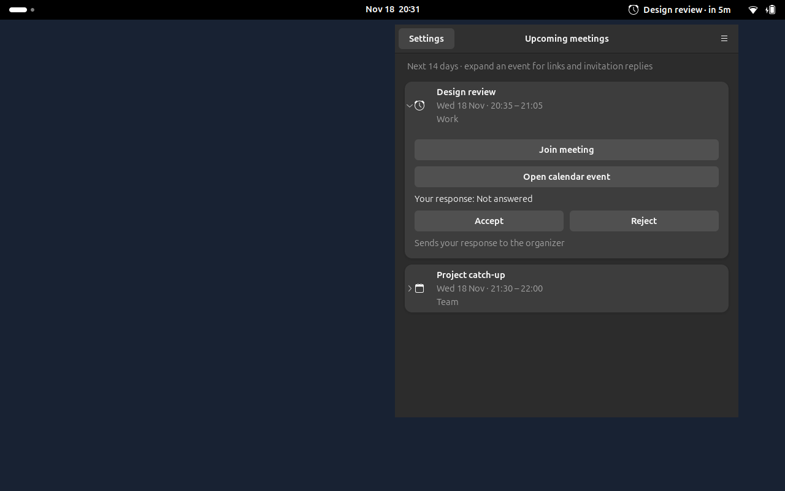
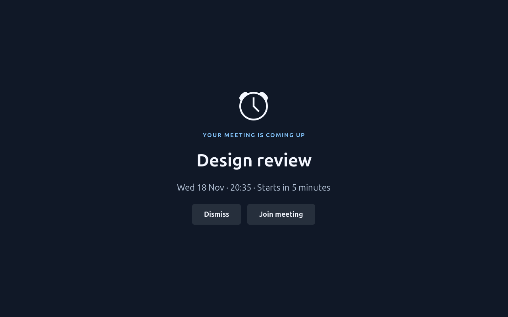

# Cal Bar

Meeting information in your top-bar with full-screen ping and direct joining options.

## Screenshots

Meeting info in the top bar, with links and invitation replies:



The full-screen reminder:



These screenshots use sample meetings.

## Install or update

Supports **GNOME Shell 46**, tested on **Ubuntu 24.04**. Download the latest release installer:

```sh
curl -fSLO https://github.com/romaad/cal-bar/releases/latest/download/install-cal-bar.sh
less install-cal-bar.sh
bash install-cal-bar.sh --install-deps
```

Or use the one-line installer:

```sh
curl -fsSL https://github.com/romaad/cal-bar/releases/latest/download/install-cal-bar.sh | bash -s -- --install-deps
```

Run as your normal desktop user. `--install-deps` installs Ubuntu dependencies with `sudo apt-get`; 
After the **first installation**, or a one-time migration from the original extension, log out and back in to load the stable bridge. Enable it if needed:

```sh
gnome-extensions enable cal-bar@local
```

Open **Cal Bar** from Applications, click its top-bar item, or use:

```sh
cal-bar                    # Open the meeting list
cal-bar preferences        # Open settings
cal-bar restart            # Restart only Cal Bar
cal-bar preview            # Preview the full-screen reminder
cal-bar refresh            # Refresh calendar data
cal-bar quit               # Stop the app and hide its panel item
cal-bar status             # Inspect the app version and bridge status
```
## Connect and select calendars

1. Open Cal Bar settings and click **Connect**. Right now we use GNOME online accounts to fetch your calendar info.
2. Choose a supported calendar provider, sign in, and enable **Calendars** for the account.
3. Return to Cal Bar settings. Calendars appear automatically; **Refresh** checks immediately.
4. Keep **Use all connected calendars** enabled to combine calendars across accounts, including newly added ones. To choose specific calendars, turn it off and check the calendars you want.

## Meeting list and invitation actions

The top bar shows the current meeting, or the next meeting within two weeks. Countdowns use compact labels like `45m`, `2h 15m`, `1d 3h`, and `1w 2d`.
Meetings are grouped by day. Expand one to reveal:

- **Join Meeting**, detecting Google Meet, Zoom, or Teams conference links. Collapsed meetings show a **Join** button too.
- **Open Event**, the calendar's web link. Without a web event URL, **Open in Calendar** opens the specific event there instead.
- For invitations, **Accept / Reject** buttons and your current response. Recurring replies affect **this occurrence only**.
- The **guest list** with each guest's response.

## Reminders

Reminders appear **5 minutes before** by default, configurable from 1–60 minutes. Set 0 or switch reminders off to disable them. A GTK reminder fills the active monitor and dims the other monitors. It stays on screen when the meeting starts, so you can still join from it. Escape, **Dismiss**, or **Join meeting** closes it. Choose from nine original melodies plus instrumental excerpts of Sayed Darwish’s **Salma Ya Salama** and **El Helwa Di** (about 14–15 seconds) in settings, with Play and Stop previews. The reminder plays your selection once and respects GNOME’s sound settings and mute. Turn **Reminder sound** off in settings for a silent overlay. **Preview reminder** also plays the sound.

Cal Bar never automatically opens reminders while locked and catches up after suspend if the meeting hasn't started. Simultaneous reminders appear sequentially as you dismiss them.

## TODO

- [ ] Add direct Google and Microsoft sign-in after registering Cal Bar with the providers.
- [ ] Test and support newer GNOME Shell versions.
- [ ] Check invitation replies with real Google and Microsoft calendars, including recurring meetings, and test Meet, Zoom, and Teams links.
- [ ] Ship a `.deb` package so Ubuntu can handle dependencies and uninstalling.

# Dev info

The launcher is in `~/.local/bin`; use `~/.local/bin/cal-bar` if needed. **Restart Cal Bar** is also available in the meeting-list menu and settings. Closing windows keeps reminders running; **Quit Cal Bar** stops them until you reopen the app.

To install from a checkout instead:

```sh
sudo apt install python3-gi gir1.2-gtk-4.0 gir1.2-adw-1 gir1.2-ecal-2.0 gir1.2-edataserver-1.2 gir1.2-goa-1.0 libglib2.0-bin gnome-calendar gnome-control-center evolution-data-server gnome-online-accounts gnome-session-canberra sound-theme-freedesktop libcanberra-pulse
./install.sh
```

See [RELEASING.md](RELEASING.md) for version tags, automated GitHub releases, prereleases, and checksums.

## Calendar providers

Shared calendars appear when GNOME's calendar service exposes them. GNOME handles authentication, token storage, refresh, and synchronization. Reconnect or remove accounts in GNOME Online Accounts; removing an account there also affects other apps that use it. If a calendar doesn't appear, check it in GNOME Calendar and enable Calendars for its account.

The previous direct Google OAuth backend is preserved for future provider registration work. Its controls remain hidden; existing OAuth settings and tokens are retained but unused by the default GNOME backend.

## Reminders
Dismissed reminder IDs and expiry timestamps are saved in `~/.local/state/cal-bar/reminders.json`, so restarting or updating the app does not repeat the same reminder. Event titles, links, and full calendar data are not saved there. Changing a meeting's start time creates a new reminder identity.

Calendar polling runs once a minute; scheduling and panel status update every five seconds. Settings detect new calendars every ten seconds while open. A failing calendar produces a warning while other calendars continue to populate the list. If the whole helper fails, the app keeps last-read events in memory and displays the error. Cal Bar does not write an event cache; Evolution Data Server may provide its own cached data while offline.

The companion can open as a normal app without the bridge. The bridge is required for the top-bar status and GNOME-controlled reminder placement above other apps. Reminders are desktop windows, not a lock screen; GNOME's own system dialogs take precedence.


## Architecture and development

To refresh the screenshots with sample meetings in a private GNOME session, run `./scripts/capture-docs.sh`.

- `extension.js`: stable bridge for panel text/icon, button activation, lock/monitor context, and native window focus/placement. It contains no calendar polling, meeting-list UI, RSVP logic, settings UI, or reminder UI.
- `cal_bar.py`: application lifecycle, D-Bus control, scheduling, account polling, and user actions.
- `companion_ui.py` / `companion.css`: GTK meeting list, event submenus, preferences, and full-screen reminder windows.
- `app_logic.py`: pure event normalization and scheduling.
- `companion_runtime.py`: settings, reminder deduplication, and cancellable isolated helper processes.
- `cal_bar_ctl.py`: independent start/restart/quit commands.
- `gnome_calendar.py`: connected account calendars and attendee responses via Evolution Data Server.
- `google_calendar.py`: hidden legacy direct OAuth backend.
- `prefs.js`: stable launcher opening settings in the companion process.

The app uses session D-Bus name `io.github.calbar.Companion`, control path `/io/github/calbar/Companion/Control`, and a small versioned status protocol. Existing GSettings are preserved. A user desktop entry, D-Bus activation file, and launcher are installed without root. The bridge starts the app when enabled and reconnects after app restarts; a crash is retried within 30 seconds while enabled.

```sh
glib-compile-schemas --strict schemas
/usr/bin/python3 -m unittest discover -s tests -p 'test_*.py'
node --check extension.js
node --check prefs.js
# Synthetic local-calendar RSVP test, with no external account:
./tests/run-eds-integration.sh
# GTK/bridge/restart test on a private D-Bus bus and two-monitor headless GNOME desktop:
./tests/run-companion-integration.sh
```

The iCalendar tests require the GNOME integration bindings; they are skipped when unavailable. Tests cover timing, current-event priority, safe URLs, multiple calendars, reply payload transport, restart-safe reminder deduplication, invitation changes, recurrence exceptions, and token refresh. Integration fixtures use synthetic events and never send replies to a real provider. Live provider replies still need validation with a test invitation on your account.

App logs: `~/.local/state/cal-bar/companion.log` (or `$XDG_STATE_HOME/cal-bar/companion.log`). Bridge logs: `journalctl --user -f -o cat`, filtering for `Cal Bar` or `JS ERROR`. Use `cal-bar restart` to load app changes; there is no need to restart GNOME Shell for them.

References: [GNOME account setup](https://help.gnome.org/gnome-help/accounts-add.html), [GNOME extension development](https://gjs.guide/extensions/development/creating.html), [GTK full-screen windows](https://docs.gtk.org/gtk4/method.Window.fullscreen_on_monitor.html), [Evolution calendar API](https://gnome.pages.gitlab.gnome.org/evolution-data-server/libecal/class.Client.html).

## License

Copyright © 2026 Cal Bar contributors. Released under the [GNU GPL version 3 or later](LICENSE).
